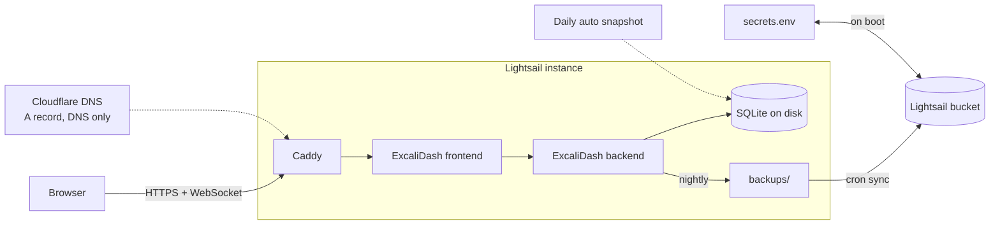

# ExcaliDash on AWS Lightsail

A self-hosted Excalidraw+ replacement. One Lightsail instance runs
[ExcaliDash](https://github.com/ZimengXiong/ExcaliDash) with Docker Compose.
AWS CDK creates every AWS resource. Total cost is about USD 8 per month.

Excalidraw+ cannot be self-hosted today. ExcaliDash gives you the parts that
matter: folders, search, live collaboration, version history, user accounts,
and plain `.excalidraw` files you can export at any time.

## Architecture



| Piece    | Choice                                                                         |
| -------- | ------------------------------------------------------------------------------ |
| Instance | Ubuntu 24.04, `micro_3_0` (1 GB RAM, 2 vCPU, 40 GB SSD), `eu-central-1`        |
| App      | Upstream ExcaliDash images, pinned tag, SQLite, images stored inside SQLite    |
| TLS      | Caddy container, Let's Encrypt, HTTP-01                                        |
| Auth     | ExcaliDash local accounts, registration closed, first admin via bootstrap code |
| Secrets  | Generated once on first boot, kept in the Lightsail bucket, no IAM keys        |
| Backups  | Daily Lightsail snapshot plus nightly SQLite copy synced to the bucket         |

## Cost

| Item                       | USD / month |
| -------------------------- | ----------- |
| Instance `micro_3_0`       | 7           |
| Bucket `small_1_0` (5 GB)  | 1           |
| Auto snapshots (7 kept)    | 0           |
| Static IP (while attached) | 0           |
| **Total**                  | **8**       |

## Prerequisites

- Node 22 and pnpm
- AWS CLI v2 with a profile for the target account
- CDK bootstrapped in `eu-central-1`: `pnpm cdk bootstrap aws://<account>/eu-central-1`
- A DNS zone you control

## Deploy

```bash
pnpm install
pnpm test
pnpm deploy --profile <your-profile> -c hostname=draw.example.com
```

Every setting has a default in `lib/config.ts`. Override any of them with `-c key=value`:

| Key                   | Default                       | Purpose                                          |
| --------------------- | ----------------------------- | ------------------------------------------------ |
| `hostname`            | `draw.awsfundamentals.com`    | Public FQDN, no scheme                           |
| `instanceName`        | `excalidash`                  | Lightsail resource name prefix                   |
| `bundleId`            | `micro_3_0`                   | Instance size. Changing it replaces the instance |
| `blueprintId`         | `ubuntu_24_04`                | OS image. Changing it replaces the instance      |
| `excalidashVersion`   | `0.6.5`                       | Image tag baked into the first boot              |
| `backupRetentionDays` | `30`                          | Days to keep backups in the bucket               |
| `bucketName`          | `<instanceName>-<account id>` | Lightsail bucket name, globally unique           |

The deploy prints five outputs: `PublicIp`, `BucketName`, `InstanceName`, `Hostname`,
and `SshCommand`.

The instance boots, installs Docker and the AWS CLI, writes the compose file and
Caddyfile, fetches or creates the secrets, and starts the stack. That takes about
five minutes. Progress is in `/var/log/excalidash-bootstrap.log` on the instance.

## DNS

Create an A record for your hostname that points at the `PublicIp` output.
Keep it DNS-only. If you use Cloudflare, the cloud must be grey, otherwise
Let's Encrypt cannot reach Caddy on port 80.

Caddy retries the certificate until the record resolves. Check with:

```bash
curl -sI https://draw.example.com
```

## First login

The first admin account needs a one-time code from the backend log.

```bash
ssh -i ~/.ssh/LightsailDefaultKey-eu-central-1.pem ubuntu@<PublicIp>
sudo docker compose -f /opt/excalidash/docker-compose.yml logs backend --tail=200 | grep "BOOTSTRAP SETUP"
```

Open the hostname in a browser, register with that code within 15 minutes, and
you are the admin. Registration is closed for everyone else. Create further
users in Admin, Access Control.

Download the default SSH key once from the Lightsail console: Account, SSH keys, `eu-central-1`.

## Backups

Two independent layers.

1. Lightsail takes a snapshot of the whole disk every day at 03:00 UTC and keeps seven.
2. ExcaliDash writes a SQLite copy to `/opt/excalidash/data/backups` at 04:00 UTC
   and keeps local copies for 14 days, or fewer if `backupRetentionDays` is lower.
   A cron job syncs that folder to the bucket at 04:30 UTC and prunes objects
   older than `backupRetentionDays`.

Run the sync by hand or dry-run the prune:

```bash
sudo /opt/excalidash/bin/backup-sync.sh
sudo DRY_RUN=1 RETENTION_DAYS=0 /opt/excalidash/bin/backup-sync.sh
```

## Restore

**Whole instance.** In the Lightsail console, pick a snapshot, create a new
instance from it, then attach the static IP to the new instance. Everything
written after the snapshot time is lost.

**Database only.** On the instance:

```bash
cd /opt/excalidash
sudo docker compose stop backend
aws s3 ls s3://<BucketName>/backups/ --region eu-central-1
aws s3 cp s3://<BucketName>/backups/<file>.db /tmp/restore.db --region eu-central-1
sudo mv data/prisma/dev.db data/prisma/dev.db.bak
sudo install -m 0600 /tmp/restore.db data/prisma/dev.db
sudo docker compose start backend
```

## Updates

```bash
sudo /opt/excalidash/bin/update.sh 0.6.1
```

The script backs up the database and syncs it to the bucket, pins both images
to the new tag, pulls, restarts, and waits for the backend health check.
Database migrations run inside the backend on start.

The first-boot script only runs once, so also pass the new version on your next
deploy with `-c excalidashVersion=0.6.1`, or change the default in `lib/config.ts`.
A replaced instance then boots on the same version as the database.

## Teardown

```bash
pnpm destroy --profile <your-profile>
```

This removes the instance and the static IP. Auto snapshots go with
the instance. The bucket is retained on purpose because it holds the secrets
and the backups. Delete it by hand when you are sure:

```bash
aws s3 rm s3://<BucketName> --recursive --region eu-central-1
aws lightsail delete-bucket --bucket-name <BucketName> --force-delete --region eu-central-1
```

A redeploy while the old bucket still exists fails, because the name is taken.
Either delete the bucket first, or deploy with `-c bucketName=<another-name>`.

## Not covered

- High availability. ExcaliDash supports one backend instance.
- PostgreSQL or S3 image storage. Both work upstream but are not wired here.
- OIDC login. Set the `OIDC_*` variables in `assets/docker-compose.yml` if you need it.
- Alarms. Add Lightsail metric alarms once you need them.
- CI. Run `pnpm test`, `pnpm typecheck`, and `pnpm lint` locally.

## Layout

```
bin/app.ts          CDK app entry
lib/config.ts       context keys, defaults, validation
lib/stack.ts        instance, static IP, bucket, outputs
lib/user-data.ts    renders assets/ into one cloud-init script
assets/             files written onto the instance on first boot
scripts/update.sh   version bump script, also installed on the instance
test/               vitest + CDK assertions
```

## Credits

ExcaliDash is by [Zimeng Xiong](https://github.com/ZimengXiong/ExcaliDash), LGPL-3.0.
This repo only references its published images. Code here is MIT.
